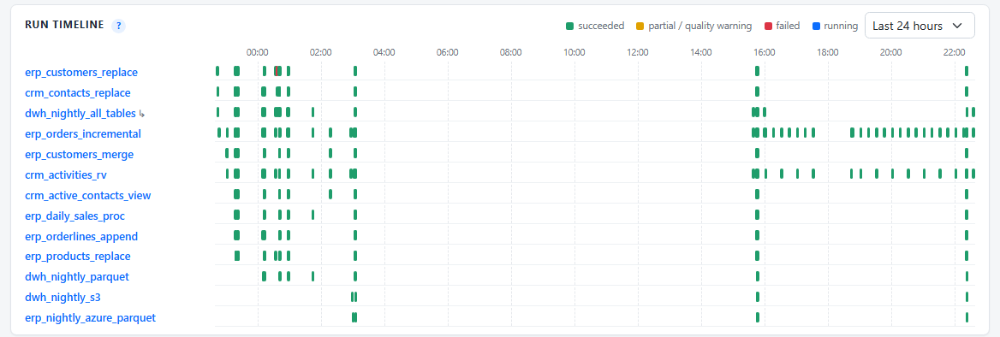
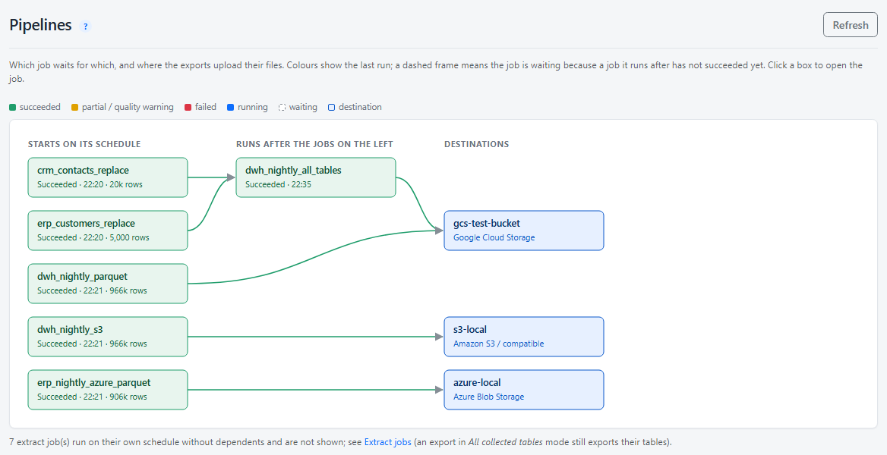

# SqlHarbor

*Collect, keep and ship your data.*

A .NET 10 application that collects data on a schedule from several **SQL Server** sources into tables on one target
SQL Server (your DWH), keeps it for a retention period, and ships what was collected as **CSV or Parquet** files to
**Google Cloud Storage, Amazon S3 / S3-compatible storage or Azure Blob Storage**. Scheduling and execution use **Hangfire**;
the UI is **Blazor Server** with sign-in through **Active Directory** (plus one local admin), in-app Help and a scenario
Guide in English and Turkish.

### Highlights

- **Collect** tables, views or free SQL with Append, Replace, Incremental (watermark) or **Merge** (upsert); consistent
  snapshot reads; strict or evolving target schemas
- **Read only what changed** with SQL Server **Change Tracking** (inserts, updates and deletes, no watermark column); move
  large tables with **parallel readers and writers**
- **Columnstore targets** for large tables – about 3.5× faster loads and 12× smaller than PAGE-compressed rowstore – with an
  automatic **storage suggestion** from the expected table size
- **Export** every night to **GCS, S3 or Azure** as CSV or Parquet: all collected tables or single tables, incremental per table
- **Dependencies**: run a job after other jobs instead of guessing times
- **Trust the data**: built-in row count integrity on every load and export, quality checks, freshness alerts
- **Protect personal data**: masking rules, an export guard and a personal data scan
- **See what happens**: run timeline, trend lines, pipeline view, alerts to e-mail / Teams / webhook
- **Operate**: job import/export as JSON (test → production), roles and database permissions, an installer and releases

<p>
  
  
</p>

*SqlHarbor* is the product name; the technical name **SqlDataCollector** stays for the projects and namespaces, the Windows
service, the program/data folders and the database objects.

---

## 1. Architecture

```
 [APP server]                    [HANGFIRE server]                  [TARGET SQL Server host]
  SqlDataCollector                SqlDataCollector                    SQL Server
  Roles = Web                     Roles = Worker                      ├─ DataCollectorMeta  (etl.*: jobs, roles, permissions, run log)
  (IIS or Windows Service)        Queues = sdc_extract,sdc_system     └─ DWH                (collected data: stage.Orders …)
        │                               │                             SqlDataCollector (optional)
        │                               │                             Roles = Worker, Queues = sdc_export
        │                               │                             → reads DWH locally, writes CSV/Parquet, uploads to GCS / S3 / Azure
        └──── all ──── Central Hangfire DB (schema hangfire_collector) ────┘
                                        └──> source SQL Servers (ERP, CRM …) – read only
```

**No code is sent to Hangfire.** When a user clicks *Save*:

1. The job definition is written to `DataCollectorMeta.etl.ExtractJob` (data).
2. A recurring entry `extract-5 → "0 2 * * *" → ExtractRunner.RunAsync(5, …)` is written to the Hangfire DB (a method invocation).

At 02:00 a Worker picks up that entry and runs its own copy of `ExtractRunner`, which reads job 5 from the metadata
database, reads the source and writes the target. Adding jobs needs no deployment; only new application versions do.

| Role | Does | Connections |
|---|---|---|
| **Web** | UI, job definitions, schedule registration, "Run now" (enqueue), monitoring | Metadata (r/w), Hangfire (r/w), sources/target read-only (lists, preview, check target) |
| **Worker** | Hangfire Server: executes extract, export, retention and sync jobs | Metadata, Hangfire, sources (read), target (write + DDL), object storage |

**Queues** route work to machines: extract jobs → `sdc_extract`, exports → `sdc_export`, system jobs → `sdc_system`
(prefixed so a shared Hangfire storage never hands our jobs to another application's servers).
`Collector:Queues` decides what a Worker takes. Recommended for large exports: a Worker **on the target SQL Server host**
with `Queues = sdc_export` (data is read locally and the files are written to that machine's disk, then uploaded), and the
central Worker with `Queues = sdc_extract,sdc_system`. Several Workers may share a queue; the same job never runs twice at once
(SQL `sp_getapplock`). Small installations can run one process with `Roles = "Web,Worker"`.

### Deployment modes

| Mode | Summary | Samples |
|---|---|---|
| **1. Embedded** | One app server, `Roles=Web,Worker`, `ConnectionStrings:Hangfire` empty → Hangfire tables in the metadata DB (`hangfire_collector` schema, created by the app) | `deploy/embedded` |
| **2a. Shared Hangfire + our Worker** | UI on the app server (`Roles=Web`); jobs in the organization's central Hangfire DB; our Worker service on the Hangfire server executes them | `deploy/shared-hangfire/web`, `…/worker` |
| **2b. Shared Hangfire + existing host** | Same, but the organization's existing Hangfire Server host references `SqlDataCollector.Core` and runs the jobs | `deploy/shared-hangfire/existing-host`, `samples/ExistingHangfireHost` |

Both shared variants may add an export Worker on the target SQL host (`deploy/shared-hangfire/worker-export-dbhost`).

---

## 2. Features

**Collecting (extract jobs)**
- Pick source tables/views – multi-select creates one job per table – columns, a WHERE filter and NOLOCK, or write free SQL
  (CTEs, temp tables, `EXEC dbo.sp …`)
- Load modes: **Append** (snapshot history) · **Replace** (only the latest successful load; optional *rebuild and swap*:
  load a fresh table, swap it in atomically, the old table stays if the load fails) · **Incremental** (watermark on
  datetime/datetime2/date/int/bigint/decimal/rowversion; the parameter uses the column's real SQL type, so no datetime
  `.003` duplicates and no lost index seeks) · **Merge** (upsert by key columns in one transaction: changed rows updated
  NULL-safe, unchanged rows untouched, new keys inserted, optionally keys missing from a full read deleted; run history shows
  `+inserted ~updated -deleted`)
- **Change Tracking** (Merge of a table): each run reads only the keys SQL Server Change Tracking recorded since the stored
  version – changed rows upserted, deleted keys (or keys leaving the filter) deleted, in one transaction; the first run and a run
  after a pause longer than the change retention read the whole table. Keys = the primary key; no watermark column needed
- **Parallel reads** (tables): 2–16 readers, each reading one slice of the split column's value range (the clustered index /
  primary key by default, or any integer or date column) over its own connection; the rows go to the target in one stream, so
  the integrity count, watermark, Merge and roll-back work unchanged
- **Parallel writes** (not for Merge): 2–8 bulk copies write into the target at once over their own connections – each
  compresses its own columnstore rowgroups; the rows of a run keep one `_LoadId`, so a failed run is still removed completely
- **Consistent reads** (optional): read the source in a SNAPSHOT transaction – one point in time, nothing skipped or read
  twice on a busy source (needs `ALLOW_SNAPSHOT_ISOLATION ON`)
- **Schema policy**: *Strict* (create if missing; an existing table must match exactly, otherwise fail with a diff) or
  *Evolve* (add columns, widen text/binary columns); **Check target** compares source and target column by column before saving
- New jobs get the target schema from the source database name (`ERP` → `erp`) – one schema per source avoids collisions
- Technical columns on every target table: `_LoadId`, `_LoadedAt`, `_ExtractJobId`, `_SourceServer`; failed loads are rolled
  back, loads interrupted by a crash are cleaned up by the next sync; decimal(38,x) is transferred exactly (`SqlDecimal`)

**Target tables and storage**
- **Rowstore** (clustered index + two nonclustered indexes) or **Columnstore** (one clustered columnstore index) per job, applied
  when the table is created. Measured on 450,000 rows: PAGE rowstore 20.1 s → columnstore 5.8 s, 41 MB → 3.3 MB; reports as
  fast, exports of a load up to 2× faster; updates slower. Works with every load mode; no xml/sql_variant columns.
- **Storage suggestion** for new jobs, applied until the user picks one: estimated target rows (Append: source rows × loads per
  day × days kept; other modes: source rows) + 25 % growth headroom → Columnstore from 1 million rows (Merge from 10 million);
  per table when several tables are selected
- Optional **daily partitioning** on `_LoadedAt` (UTC): retention drops whole days with `TRUNCATE … WITH (PARTITIONS)`;
  future partitions are created automatically
- **Retention** per job within an organization-wide policy (default, maximum, "keep forever" allowed or not)

**Exporting to the cloud**
- **Destinations** (Admin → *Destinations*): **Google Cloud Storage**, **Amazon S3** and S3-compatible storage (MinIO, Wasabi,
  Ceph), **Azure Blob Storage** incl. ADLS Gen2 – access keys, connection strings, SAS, service account keys or the server's own
  identity (AWS role, Managed Identity). Keys are stored encrypted and never shown again; *Test* writes a small object.
- **All collected tables** (nightly): every collected table of a database, one file set per table, only the loads since that
  table's previous export ("what was collected today"); new tables are picked up automatically; per-table state, so one failing
  table does not block the others and a retry only redoes what is missing. **Single table** (full or incremental) and
  **custom query** (`@RunDate`, `@RunAtUtc`) modes too.
- **CSV or Parquet** per job. CSV: RFC 4180 (delimiter, quoting, LF/CRLF, NULL value, UTF-8 BOM), plain or gzip upload.
  Parquet: typed columns (exact decimals up to 38 digits, timestamps, binary), Snappy/Zstd/Gzip, row groups – read directly by
  BigQuery, Spark, Databricks, pandas. Both split by max rows per file.
- Object names with tokens `{Name} {Database} {Schema} {Table} {Date} {DateCompact} {Time} {Part}`; a run manifest per export;
  multipart/resumable uploads with retries and size verification; a load still running is never exported half-done; the local
  archive is always gzip

**Scheduling and dependencies**
- Each job runs **on a cron schedule** (in its time zone, next runs previewed) or **after other jobs**: it starts as soon as every
  selected extract/export has succeeded again – e.g. the nightly export right after all extracts. Each upstream success is used
  once; loops are refused.

**Trusting the data**
- **Integrity, always on**: every extract checks *rows read = rows arrived*, every export re-counts the rows in the written files
  against the rows read, every upload verifies the object size; a mismatch fails the run
- **Quality checks** after every load: minimum rows, row count change vs. the last 10 loads, source count reconciliation, NULL
  share, duplicate keys, custom SQL. *Warning* or *Error*; a failed check keeps dependent jobs waiting and sends an alert.
- **Freshness**: alert when a job has no good load for N hours

**Data protection**
- **Masking rules** by column name pattern and scope: Hash (keyed HMAC-SHA256 – joinable, not reversible), Partial, Email,
  Redact, Null; applied to the exported files only or already when collecting
- **Export guard** (Off / Warn / Block): the first rows of every export are checked for e-mail addresses, Turkish national IDs,
  IBANs, card numbers and phone numbers in unmasked columns
- **Personal data scan** of the collected tables with one-click *Create rule*

**Monitoring** (drawn by the application itself – works without internet access)
- **Status**: workers online, queue, the last run of every job and a **run timeline** – one lane per job, one bar per run
  (start, duration, outcome) for the last 6/12/24 hours or 3 days
- **Trend lines** of rows and duration over the last 30 runs; an amber end point when a run is far from the usual value
- **Pipelines**: which job waits for which and where exports upload, coloured by the last run, *waiting* jobs dashed
- **Alerts** for failures, partial failures, missed runs, quality problems, stale jobs and recoveries – e-mail, Microsoft Teams
  or a JSON webhook, plus each job's own *Notify* addresses
- Run history with timings, audit log, permission check of the service accounts, Hangfire dashboard

**Operations**
- **Import / export of job definitions** as JSON (UI and CLI `jobs-export` / `jobs-import`): test → production, backups,
  version control. Servers, destinations and upstream jobs by name, no secrets; planned first with the same checks as *Save*,
  nothing saved while there is an error; new jobs inactive by default.
- Roles **Admin / Editor / Viewer** for AD users or groups, server/database permissions enforced on save
- **Settings** without restart: retention policy and schedule, run history / audit retention, HTTPS certificate (PKCS#12 or the
  Windows store), the GCS credential
- **Installer** (`SqlHarbor-Setup.exe`, wizard or silent) and a GitHub release per version tag
- In-app **Help** in **English and Turkish** and a **Guide** of ten scenarios (first steps, a nightly table, large tables, the
  nightly export, personal data, trusting the data, alerts, access, moving jobs to production, failures) with screenshots

---

## 3. Why not bcp for the CSV export?

Measured on the same 1,000,000-row table (8 columns, Turkish text, some values with commas, quotes and line breaks),
SQL Server and exporter on the same machine (2 vCPU):

| | Time | Correct CSV? |
|---|---|---|
| bcp `-c -t,` (CSV only) | 1.9 s | **No** – 52,941 extra lines (embedded line breaks split rows), unquoted commas shift columns, no header row, empty string vs NULL lost |
| bcp + separate `gzip -6` | 1.9 + 3.7 = 5.6 s | No (same) |
| SqlDataCollector, plain CSV | 1.8 s (warm) | Yes – 1,000,000 rows, 0 rows with wrong field count |
| SqlDataCollector, CSV + gzip (streamed) | 3.3 s | Yes |
| bcp `-n` (native binary) | 0.8 s | not CSV |

Upload time depends on bytes: gzip reduced 113 MB to 38 MB. The locality benefit of exporting on the database host is
achieved with an export-only Worker on that host (see Architecture) – no `xp_cmdshell` needed.

---

## 4. Installation

### 4.0 Installer (recommended)
```powershell
.\scripts\dev.ps1 installer        # -> artifacts\installer\dist\SqlHarbor-Setup.exe
```
`SqlHarbor-Setup.exe` is one self-contained file (application + .NET runtime + wizard): nothing has to be installed on
the server except an existing SQL Server. Requirements: Windows Server joined to the AD domain, a domain service account
(or gMSA). The wizard asks, in this order:

1. **Mode** – *Embedded* (one server, Hangfire in the metadata DB) or *Central* (organization's Hangfire DB; Web and/or Worker on this server).
2. **Service account** – verified against the domain; gets "Log on as a service"; the service runs as this account.
3. **Databases** – *create now* with the installing user's Windows account (databases, etl schema, permissions, `sdc_export_reader`),
   or *later*: scripts in `<program folder>\sql` for the DBA (`01_databases_and_permissions.sql`, `02_etl_schema.sql`,
   central: `03_hangfire_central.sql`). Until the metadata DB is ready the app serves a *setup required* page and restarts itself once it is.
4. **Web and HTTPS** – host name, port (443), self-signed certificate, firewall rule, program and data folder
   (`%ProgramData%\SqlDataCollector`: `certs\`, `exports\` = temporary CSV files / archive).

The service is registered (automatic delayed start, restart on failure) and started; *Open SqlDataCollector* opens
`https://localhost/login`. **First sign-in** (only possible on the server itself): *Local administrator* asks for a new
password – there is no default. Then: grant roles to AD groups (*Permissions*), add the export destinations (GCS, S3 or Azure
keys on *Destinations*) and import the corporate HTTPS certificate (*Settings*). Kerberos: `setspn -S HTTP/<host> <service account>`.

Silent installation: `SqlHarbor-Setup.exe /silent /config install.json /password-env SDC_PWD [/log file] [/dryrun]`
(the JSON has the wizard's fields, e.g. `{"Mode":"Embedded","ServiceAccount":"CORP\\svc-sdc","SqlServer":"sql01","MetadataDb":"SdcMeta","DwhDb":"DWH","DatabaseAction":"Now","HostName":"sdc.corp.local"}`).
Running the setup again upgrades the binaries and keeps the configuration. Uninstall: *Apps & features* or `/uninstall [/purge]`.

**GitHub release:** pushing a version tag builds the installer on a GitHub-hosted Windows runner
(`.github/workflows/release.yml`: build with warnings as errors, unit tests, `dev.ps1 installer`, SHA-256) and attaches
`SqlHarbor-Setup.exe` and its `.sha256` to a release of this repository:
```powershell
git tag v1.0.0
git push origin v1.0.0
```
The version (`1.0.0`) is stamped into the application and the setup. *Actions → Release installer → Run workflow* builds
without releasing (the exe is kept as a workflow artifact for 14 days). The exe is not code-signed (SmartScreen may warn).

Manual installation (below) remains possible.

### 4.1 Build
```powershell
dotnet publish src/SqlDataCollector -c Release -r win-x64 --self-contained false -o D:\SqlDataCollector\app
```

### 4.2 Databases
1. On the target SQL Server create `DataCollectorMeta` and `DWH`.
2. *Embedded mode:* nothing to do – the app creates `hangfire_collector` in the metadata DB (`HangfirePrepareSchema=true`).
   *Shared mode:* generate the install script for the central Hangfire DB and hand it to the DBA:
   ```powershell
   SqlDataCollector.exe hangfire-install-script hangfire_collector "CORP\sdc-web$" "CORP\sdc-worker$" > hangfire_install.sql
   ```
   It creates the `hangfire_collector` schema and grants the two accounts **only** SELECT/INSERT/UPDATE/DELETE on it
   (keep `Collector:HangfirePrepareSchema = false`).
3. Service account permissions: `sql/01_permissions_template.sql` – including the read-only `sdc_export_reader` user in `DWH`
   (and every other database exports read from), which export reads switch to.
4. The `etl.*` schema is installed on first start (`AutoCreateSchema=true`, needs `db_ddladmin` at that moment), or the DBA
   runs `SqlDataCollector.exe metadata-install "<connection string>"` (or `src/SqlDataCollector.Core/Sql/001_schema.sql`) and you set `AutoCreateSchema=false`.

### 4.3 Local admin password
```powershell
SqlDataCollector.exe hash-password      # paste the output into LocalAdmin:PasswordHash
```
Sign in as local admin first, then grant the Admin role to an AD group on **Permissions** (or use `sql/02_bootstrap_example.sql`).

On **Servers** define the target server(s) and the source servers (the metadata and Hangfire databases are shown there
read-only, as configured in appsettings). Then click **Check permissions**: the Web account is checked directly and a
check job is queued on every queue a live Hangfire server listens to, so each Worker verifies its own account. Missing
permissions (vs. `sql/01_permissions_template.sql`) and permissions that must not exist (write/DDL on sources, write on
targets for a Web-only process, rights outside our schema in a shared Hangfire database) are listed per process.
Workers also run this check on startup and log problems as warnings.

### 4.4 Workers (Windows Service)
```powershell
# central Hangfire server – appsettings: "Roles": "Worker", "Queues": "sdc_extract,sdc_system"
sc.exe create SqlDataCollectorWorker binPath= "D:\SqlDataCollector\app\SqlDataCollector.exe" start= delayed-auto obj= "CORP\sdc-worker$"
sc.exe failure SqlDataCollectorWorker reset= 86400 actions= restart/60000/restart/60000/restart/300000
sc.exe start SqlDataCollectorWorker

# optional export Worker on the target SQL Server host – "Roles": "Worker", "Queues": "sdc_export",
#   "WorkDirectory": "E:\\exports", "KeepLocalFiles": true, "LocalFileRetentionDays": 7
#   needs outbound HTTPS (443) to storage.googleapis.com
```
With a gMSA (`…$`) no password is entered.

### 4.5 Web (app server)
- **IIS:** install the ASP.NET Core Hosting Bundle 10, app pool identity `CORP\sdc-web$`, enable **Windows Authentication + Anonymous**
  (anonymous is required for the sign-in page and static files).
- **Windows Service (Kestrel):** as above with `Roles=Web`. Register `setspn -S HTTP/sdc.corp.local CORP\sdc-web$` for Kerberos (NTLM works without it).
- Use HTTPS in production (IIS binding or `Kestrel:Endpoints`).

### 4.6 appsettings.json (base file = embedded defaults; per-mode overrides in `deploy/`)
| Setting | Description |
|---|---|
| `ConnectionStrings:Metadata` | etl.* database (on the target server, separate DB) |
| `ConnectionStrings:Hangfire` | Central Hangfire DB (falls back to Metadata if empty) |
| `Collector:Roles` | `Web`, `Worker` or `Web,Worker` |
| `Collector:Queues` | Queues a Worker serves, e.g. `sdc_export` or `sdc_extract,sdc_system` (default: all three) |
| `Collector:HangfireSchema` / `HangfirePrepareSchema` | Default `hangfire_collector`; `true` for embedded, `false` for a DBA-managed shared schema |
| `Collector:WorkerCount` | Concurrent jobs per Worker |
| `Collector:TargetTableCompression` | New target tables: `NONE` / `ROW` / `PAGE` |
| `Collector:WorkDirectory` / `KeepLocalFiles` / `LocalFileRetentionDays` | Local day folders; archive kept as `.csv.gz` for N days |
| `Collector:ExportReadAsUser` | Read-only database user export reads switch to (default `sdc_export_reader`; empty = off, not recommended) |
| `Alerts:Smtp:Host` / `Port` / `Security` / `From` / `UserName` / `Password` | SMTP for e-mail alerts (internal relay recommended; `Security`: Auto, None, StartTls, SslOnConnect) |
| `Alerts:PublicUrl` | Base URL of the UI for links in alerts |
| `Https:Port` / `HttpRedirectPort` / `HostName` / `CertificateDirectory` | HTTPS served by Kestrel (0 = off, Urls used); self-signed certificate until one is imported on Settings |
| `Secrets:Key` | AES-256 key (base64, 32 bytes) for secrets stored in the metadata DB (destination keys, the GCS credential); the same on all servers of an installation |
| `Collector:RetentionCron` / `RunLogRetentionDays` | Initial values only: once saved on **Settings**, the values in `etl.SystemSetting` win |
| `Gcs:CredentialsPath` | Optional service account JSON file; empty = the key uploaded on Settings, else Application Default Credentials (needs `roles/storage.objectCreator`) |
| `Gcs:Endpoint` | Optional (Private Service Connect / emulator) |
| `SqlCredentialOverrides:<ServerName>` | **Only** for non-domain servers or tests (`User ID=..;Password=..`); normally empty |

Secrets can come from environment variables: `ConnectionStrings__Metadata`, `LocalAdmin__PasswordHash`, …

---

## 5. Daily flow (example)

| Time | Job | Worker |
|---|---|---|
| 00:00–00:30 | Extract jobs (ERP, CRM → DWH.stage.*) | central (`sdc_extract`) |
| 01:00 (or *after* the extract jobs) | Export *All collected tables* (DWH) to GCS / S3 / Azure → one file set per table with that day's loads | DB host (`sdc_export`) |
| 01:30 | Retention (old days removed, partitions truncated) | central (`sdc_system`) |

---

## 6. Security notes
- No SQL passwords stored; all connections use the service account (Integrated Security).
- Editors can write SQL (filters, column expressions, queries). The real boundary on sources is the Worker account's
  permissions: grant **read only** on sources. Export queries run on the target with the Worker account; give the Editor
  role to trusted people. **Servers → Check permissions** reports write/DDL permissions on sources as *Excess*.
- Export reads and export previews run on the target as the read-only database user `Collector:ExportReadAsUser`
  (default `sdc_export_reader`, `CREATE USER … WITHOUT LOGIN` + `db_datareader`) via `EXECUTE AS USER … WITH COOKIE`,
  so export SQL cannot write, drop or `REVERT` to the Worker's rights. Create the user (and `GRANT IMPERSONATE` to both
  service accounts) when the target database is set up – see `sql/01_permissions_template.sql`. Empty setting = disabled.
- Local admin: PBKDF2-SHA256 hash, lockout after 5 failures for 15 minutes, antiforgery-protected form.

---

## 7. CLI commands

```powershell
SqlDataCollector.exe hash-password                                         # PBKDF2 hash for LocalAdmin:PasswordHash
SqlDataCollector.exe hangfire-install-script [schema] [accounts…] > x.sql  # DBA script for a shared Hangfire DB
SqlDataCollector.exe hangfire-install "<connection string>" [schema]       # install Hangfire tables directly
SqlDataCollector.exe metadata-install "<connection string>"                # install/upgrade the etl.* schema
SqlDataCollector.exe run-job extract|export <id|all>                       # run job(s) in-process now (exit code 0 = OK)
SqlDataCollector.exe jobs-export jobs.json [--extract 1,2] [--export 3] [--no-upstreams]   # job definitions -> JSON (default: all jobs)
SqlDataCollector.exe jobs-import jobs.json [--dry-run] [--update-existing] [--keep-active] [--map-server FILE=HERE]... [--map-destination FILE=HERE]...
SqlDataCollector.exe create-cert --host sdc.corp.local [--dir <folder>]      # self-signed HTTPS certificate (installer)
SqlDataCollector.exe db-script --meta M --dwh D [--account DOMAIN\svc] [--central --hangfire-db H] --out <folder>   # DBA scripts
SqlDataCollector.exe db-install --server S --meta M --dwh D [--account DOMAIN\svc] [--trust-server-certificate]   # run them (current Windows account)
SqlDataCollector.exe new-secret-key                                         # value for Secrets:Key
```

---

## 8. Development and tests

Prerequisites: .NET 10 SDK, Docker Desktop (Linux containers), a local SQL Server (Developer/Express) reachable with
Windows authentication, PowerShell.

```powershell
.\scripts\dev.ps1 setup      # Docker sources ERP (:14331) + CRM (:14332) with demo data, storage emulators GCS (:4443),
                             # S3-compatible s3mock (:9090, bucket dwh-exports), Azure Azurite (:10000, container exports),
                             # SdcMeta + SdcDwh on the local SQL Server, 8 extract jobs + 1 export job, appsettings.LocalTest.json
.\scripts\dev.ps1 run        # app on http://localhost:5080 (admin / Admin!Dev2026, or your Windows account = Admin)
.\scripts\dev.ps1 smoke      # all extracts → simulate source changes → incremental → all-tables export → check emulator
.\scripts\dev.ps1 test       # unit + Testcontainers integration tests
.\scripts\dev.ps1 full-up    # embedded mode completely in Docker (http://localhost:8080)
.\scripts\dev.ps1 shared-up  # shared Hangfire mode in Docker: web + corporate-host + export worker
.\scripts\dev.ps1 down       # stop containers
```

Named SQL instance: `-SqlInstance "localhost\SQLEXPRESS"`. Claude Code users: see `CLAUDE.md` and `.claude/`.

---

## 9. Project layout
```
src/SqlDataCollector.Core/   job library without ASP.NET (Extract/, Export/, Scheduling/, Infrastructure/, Services/, Sql/001_schema.sql)
src/SqlDataCollector/        host: Program.cs (roles, queues, auth, Hangfire, CLI), Security/, Components/ (Blazor UI, Help)
samples/ExistingHangfireHost/  organization Hangfire host running our jobs (deployment 2b)
tests/SqlDataCollector.Tests/  unit + Testcontainers integration tests
docker/                      compose.yml, Dockerfile, seed SQL for demo sources
deploy/                      appsettings per deployment mode
scripts/dev.ps1              local environment and test commands
sql/                         permission template, bootstrap example
```
